# 상세 사용 가이드

이 문서는 EMG 팔찌 PC 프로그램(EMG Bracelet)의 사용 설명서입니다.
팔찌를 차고 손동작을 녹화한 뒤, 그 데이터로 사용자 전용 동작 인식 모델을 만들어 팔찌에 넣고, 실제로 잘 인식하는지 확인하기까지의 과정을 화면 순서대로 설명합니다.

- 처음 사용한다면 [3절 New subject](#3-new-subject-모델-만들기-phase-05)를 순서대로 따라 하세요.
- 프로그램 설치는 [INSTALLATION_GUIDE.md](INSTALLATION_GUIDE.md), 핵심만 짧게 보려면 [USER_GUIDE.md](USER_GUIDE.md)를 보세요.

---

## 목차

1. [앱 실행](#1-앱-실행)
2. [시작 메뉴](#2-시작-메뉴)
3. [New subject: 모델 만들기 (Phase 0~5)](#3-new-subject-모델-만들기-phase-05)
   - [공통 화면 구성](#31-공통-화면-구성)
   - [Phase 0. Firmware](#32-phase-0-firmware--캡처-펌웨어-설치)
   - [Phase 1. Capture](#33-phase-1-capture--녹화)
   - [Phase 2. Training](#34-phase-2-training--모델-학습)
   - [Phase 3. Install](#35-phase-3-install--팔찌에-모델-설치)
   - [Phase 4. Verify](#36-phase-4-verify--실시간-확인)
   - [Phase 5. Score](#37-phase-5-score--온라인-점수-측정)
4. [Load an old session: 예전 모델 불러오기](#4-load-an-old-session-예전-모델-불러오기)
5. [Browse takes: 녹화본 둘러보기](#5-browse-takes-녹화본-둘러보기)
6. [Subjects directory: 피험자 목록](#6-subjects-directory-피험자-목록)
7. [Pair robotic hand: 의수 페어링](#7-pair-robotic-hand-의수-페어링)
8. [EMG sensors debugging: 신호 확인](#8-emg-sensors-debugging-신호-확인)
9. [팔찌 선택 창 (Choose bracelet)](#9-팔찌-선택-창-choose-bracelet)
10. [저장되는 파일](#10-저장되는-파일)
11. [자주 겪는 문제](#11-자주-겪는-문제)

---

## 1. 앱 실행

프로젝트 폴더에서 PowerShell을 열고 실행합니다.

```powershell
.venv\Scripts\python.exe client_app\main.py
```

앱 창과 함께 터미널 창이 열려 있습니다. 팔찌가 연결되면 터미널에 1초마다 `[BLE] 1150 Hz | 57.5 pkt/s` 같은 수신 상태가 찍힙니다. **이 줄이 멈추면 팔찌 신호가 끊긴 것**이니 터미널 창은 닫지 말고 옆에 두세요.

---

## 2. 시작 메뉴

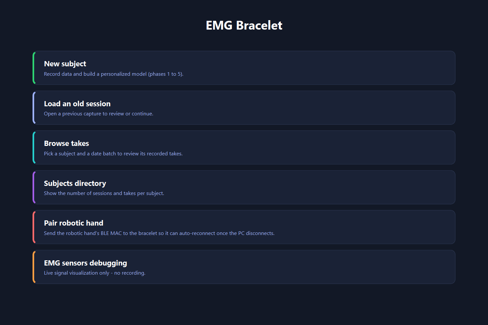

앱을 켜면 처음 나오는 화면입니다. 카드를 누르면 해당 화면으로 갑니다. 어느 화면에서든 왼쪽 위 **← Menu** 버튼을 누르면 이 메뉴로 돌아옵니다.

| 카드 | 하는 일 | 언제 쓰나 |
|---|---|---|
| **New subject** | 녹화 → 학습 → 설치 → 확인까지 (Phase 0~5) | 처음 쓰는 사람의 모델을 만들 때, 같은 사람의 데이터를 새로 녹화할 때 |
| **Load an old session** | 예전에 학습한 모델을 골라 팔찌에 다시 설치 | 다시 녹화하지 않고 예전 모델을 쓰고 싶을 때 |
| **Browse takes** | 녹화해 둔 데이터를 피험자·날짜별로 열어 보기 | 녹화가 잘 됐는지 확인하거나 잘못된 녹화를 지울 때 |
| **Subjects directory** | 피험자별 학습 횟수·녹화 수 보기, 피험자 삭제 | 누가 얼마나 녹화했는지 볼 때 |
| **Pair robotic hand** | 팔찌와 로봇 의수를 연결 | 의수를 사용할 때 ([7절](#7-pair-robotic-hand-의수-페어링)) |
| **EMG sensors debugging** | 녹화 없이 신호만 실시간으로 보기 | 팔찌 착용 상태·센서 접촉을 확인할 때 |

---

## 3. New subject: 모델 만들기 (Phase 0~5)

### 3.1 공통 화면 구성

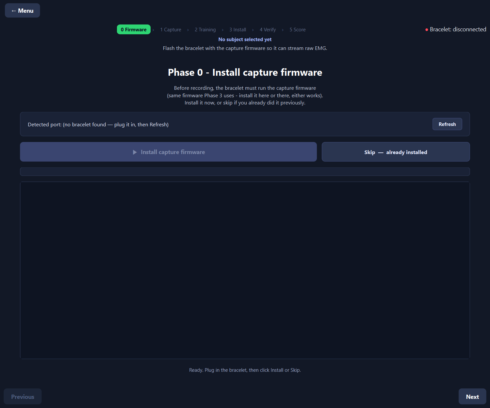

New subject의 모든 화면은 위아래 구성이 같습니다.

- **단계 표시줄 (맨 위 가운데):** `0 Firmware › 1 Capture › 2 Training › 3 Install › 4 Verify › 5 Score`
  - 초록 배경 칩이 지금 단계입니다. 초록 글씨는 지나온 단계, 회색 글씨는 아직 안 한 단계입니다.
- **피험자 표시 (단계 표시줄 아래):** 지금 작업 중인 피험자 ID가 나옵니다. 아직 고르지 않았으면 `No subject selected yet`.
- **단계 설명 (그 아래 한 줄):** 이 단계에서 할 일을 한 줄로 알려 줍니다.
- **팔찌 연결 상태 (오른쪽 위):** `● Bracelet: disconnected`(빨강) 또는 `● Bracelet: connected`(초록).
- **Previous / Next (맨 아래):** 이전·다음 단계로 이동합니다. 단계는 건너뛸 수 있지만, 처음이라면 순서대로 진행하세요.

화면이 창보다 길면 오른쪽 스크롤 막대로 내려 볼 수 있습니다.

---

### 3.2 Phase 0. Firmware — 캡처 펌웨어 설치


녹화하려면 팔찌에 **캡처 펌웨어**가 들어 있어야 합니다. 팔찌를 받은 뒤 처음 한 번만 하면 됩니다.

| 화면 요소 | 설명 |
|---|---|
| **Detected port** | USB로 연결된 팔찌의 포트입니다. `(no bracelet found — plug it in, then Refresh)`이면 팔찌를 찾지 못한 것입니다. |
| **Refresh** | 팔찌를 꽂은 뒤 눌러 포트를 다시 찾습니다. |
| **▶ Install capture firmware** | 펌웨어를 설치합니다. 포트를 찾았을 때만 눌립니다. |
| **Skip — already installed** | 이미 설치된 팔찌면 눌러 Phase 1로 넘어갑니다. |
| 진행 막대와 로그 창 | 설치 진행 상황과 메시지가 나옵니다. |

**순서**

1. 팔찌를 USB 케이블로 PC에 꽂습니다.
2. **Refresh**를 눌러 `Detected port: COM5`처럼 포트가 나오는지 확인합니다.
3. **▶ Install capture firmware**를 누릅니다. 버튼이 `⏳ Installing… do not unplug`으로 바뀝니다. **이때 케이블을 뽑지 마세요.**
4. 1~2분 뒤 `Done. Click Next to start recording.`이 나오면 **Next**를 누릅니다.
5. 실패하면 `Install failed. See log above.`가 나옵니다. 로그 창을 확인하고, 케이블과 포트를 확인한 뒤 다시 시도하세요.

**설치 화면**

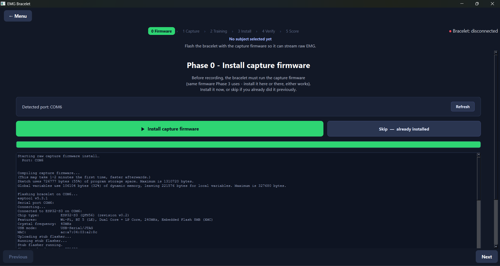

- 팔찌를 꽂으면 `Detected port: COM6`처럼 포트가 잡히고 **▶ Install capture firmware**가 초록으로 켜집니다.
- 누르면 로그 창에 진행 상황이 나옵니다. 핵심만 보면 됩니다.
  1. `Compiling capture firmware...`: 펌웨어를 만드는 중입니다. 처음에는 1~2분, 다음부터는 더 빠릅니다.
  2. `Flashing bracelet on COM6...` → `Connected to ESP32-S3 on COM6`: 팔찌에 연결됐습니다.
  3. `Writing at ... 100.0%`, `Hash of data verified.`: 펌웨어를 쓰고 제대로 써졌는지 확인합니다.

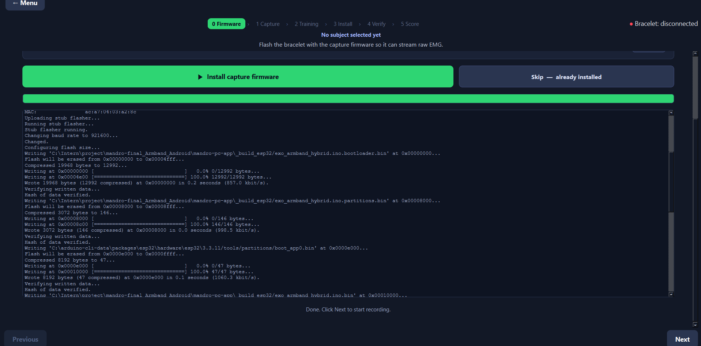

- 마지막에 `✅ Capture firmware installed. You can now move to Phase 1.`과 화면 아래 `Done. Click Next to start recording.`이 나오면 끝입니다. **Next**를 눌러 Phase 1로 갑니다.

> 이 펌웨어는 Phase 3에서 설치하는 것과 같습니다. 어느 쪽에서 설치해도 됩니다.

---

### 3.3 Phase 1. Capture — 녹화

Phase 1은 화면 3개로 이어집니다: **준비 → 캘리브레이션 → 녹화**.

#### ① 준비 화면 (Let's build your personalized model)

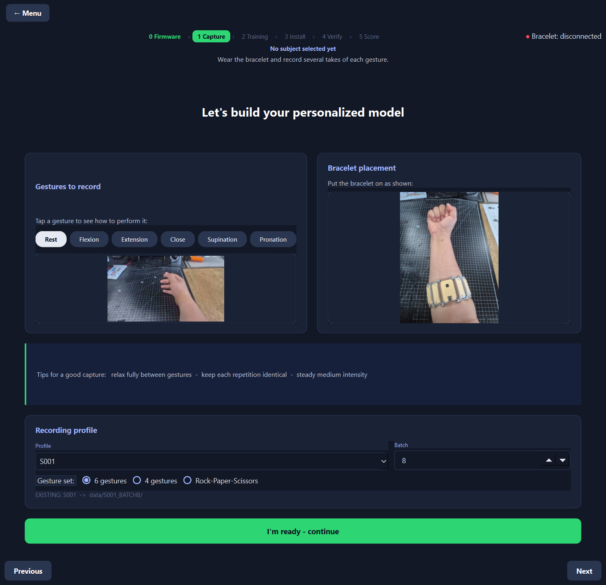

**Gestures to record (왼쪽 카드)**

녹화할 손동작 목록입니다. 버튼을 누르면 아래에 그 동작의 시연 영상이 나옵니다. 녹화 전에 하나씩 눌러 동작을 익혀 두세요.

| 버튼 | 동작 |
|---|---|
| Rest | 힘 빼고 쉬기 |
| Flexion | 손목 굽히기 |
| Extension | 손목 펴기 |
| Close | 주먹 쥐기 |
| Supination | 손바닥을 위로 돌리기 |
| Pronation | 손바닥을 아래로 돌리기 |

**Bracelet placement (오른쪽 카드)**

팔찌를 차는 위치입니다. 사진처럼 팔뚝의 굵은 부분에, 센서가 피부에 꼭 닿도록 찹니다.

**Tips for a good capture (초록 줄 상자)**

- 동작 사이에는 힘을 완전히 뺍니다.
- 매번 같은 동작을 똑같이 합니다.
- 힘은 너무 세지도 약하지도 않게, 일정하게 줍니다.

**Recording profile (아래 카드)**

| 항목 | 설명 |
|---|---|
| **Profile** | 피험자를 고릅니다. 이미 등록된 사람이면 ID(예: `S001`)를 고르고, 처음이면 `+ New profile...`을 고릅니다. 새 피험자는 다음 번호(`S010` 등)가 자동으로 붙습니다. |
| **Batch** | 이번 녹화 묶음 번호입니다. 같은 사람이 여러 번 녹화하면 1, 2, 3…으로 늘어납니다. 기존 피험자를 고르면 다음 번호가 자동으로 들어갑니다. |
| **Gesture set** | 녹화할 동작 묶음입니다. `6 gestures`(위 6개 모두), `4 gestures`(Rest·Flexion·Extension·Close), `Rock-Paper-Scissors`(가위바위보). 고르면 왼쪽 동작 버튼도 그에 맞게 바뀝니다. |
| 회색 안내 줄 | 녹화가 저장될 위치입니다. 예: `EXISTING: S001 -> data/S001_BATCH8/` |

다 고르면 **I'm ready - continue**를 누릅니다.

> 이름 같은 개인정보는 받지 않습니다. 피험자는 ID 번호로만 구분합니다.

#### ② 캘리브레이션 화면 (Calibration — resting signal baseline)

팔에 힘을 뺀 상태의 신호를 5초 동안 재서 기준값으로 씁니다. 이 기준값으로 녹화 중 잡음을 판단합니다.

| 화면 요소 | 설명 |
|---|---|
| **Sensor contact** | 채널 8개(CH0~CH7)의 접촉 상태입니다. 연결 전에는 회색, 신호가 잘 들어오면 초록, 전극이 피부에 닿지 않으면 빨강입니다. |
| 상태 안내 상자 | 지금 할 일과 결과를 알려 줍니다. |
| **Connect bracelet** | 팔찌와 무선(BLE)으로 연결합니다. 연결되면 빨간 **Disconnect bracelet**으로 바뀝니다. |
| **← Back** | 준비 화면으로 돌아갑니다. |
| **Start calibration** | 5초 측정을 시작합니다. 끝나면 **Re-calibrate**로 바뀌어 다시 잴 수 있습니다. |
| **Continue to capture →** | 캘리브레이션이 끝나야 눌립니다. 녹화 화면으로 갑니다. |

**순서**

1. 팔찌를 차고 전원을 켭니다.
2. **Connect bracelet**을 누릅니다. 오른쪽 위가 `● Bracelet: connected`로 바뀌는지 봅니다. Sensor contact 칩은 캘리브레이션을 시작해야 색이 바뀝니다.
   - 팔찌의 LED로도 연결 상태를 확인할 수 있습니다. PC와 연결되기 전에는 **주황색**(빨간빛이 도는 주황), 연결되면 **파란색**으로 바뀝니다.

   연결되면 아래처럼 버튼이 빨간 **Disconnect bracelet**으로 바뀝니다. 다시 누르면 연결이 끊깁니다.

   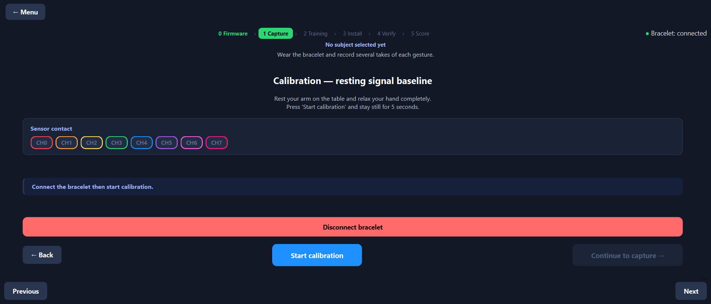

3. 팔을 책상에 올려 두고 손에 힘을 완전히 뺍니다.
4. **Start calibration**을 누르고 5초 동안 움직이지 않습니다.
5. 결과를 확인합니다. **모든 채널이 통과(✓)해야 다음으로 넘어갑니다.**

**Measured baseline noise per channel**에 채널별 평균(mean)과 잡음 크기(noise σ)가 나옵니다.

- `✓`(초록): 정상입니다.
- `⚠`(빨강): 다른 채널보다 잡음이 2배 넘게 큽니다.

**잡음이 튀어 통과하지 못한 경우**

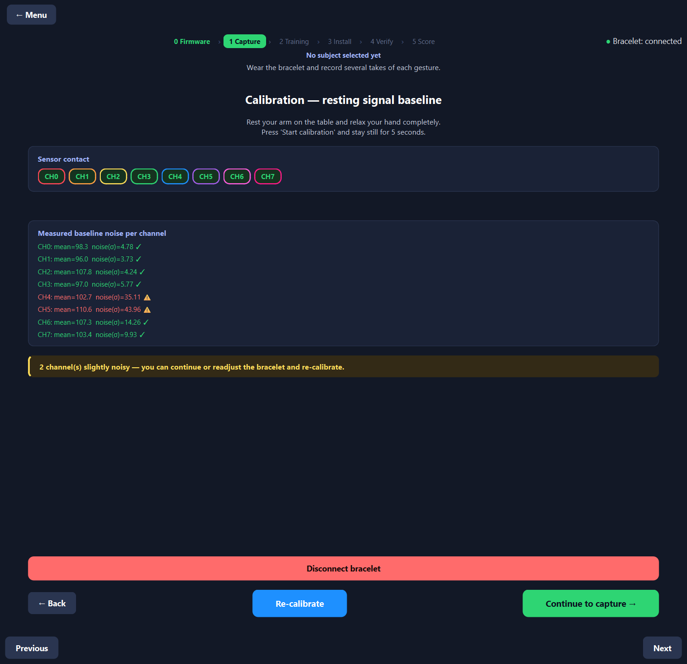

위 화면은 CH4·CH5의 잡음이 다른 채널보다 훨씬 커서 `⚠`가 뜬 경우입니다. 이 상태로 녹화하면 그 채널의 데이터가 잡음에 묻혀 모델 정확도가 떨어집니다. 이렇게 하세요.

1. `⚠`가 뜬 채널 쪽 센서가 피부에 꼭 닿도록 팔찌를 다시 찹니다. 너무 헐거우면 한 칸 조이고, 땀이나 이물질이 있으면 닦습니다.
2. 팔을 책상에 편하게 올리고 손·손가락에 힘을 완전히 뺍니다. 말하거나 몸을 움직이지 않습니다.
3. 신호가 안정되도록 몇 초 기다린 뒤 **Re-calibrate**를 누릅니다.
4. 모든 채널이 `✓`가 될 때까지 1~3을 반복합니다.

**모든 채널이 통과한 경우**

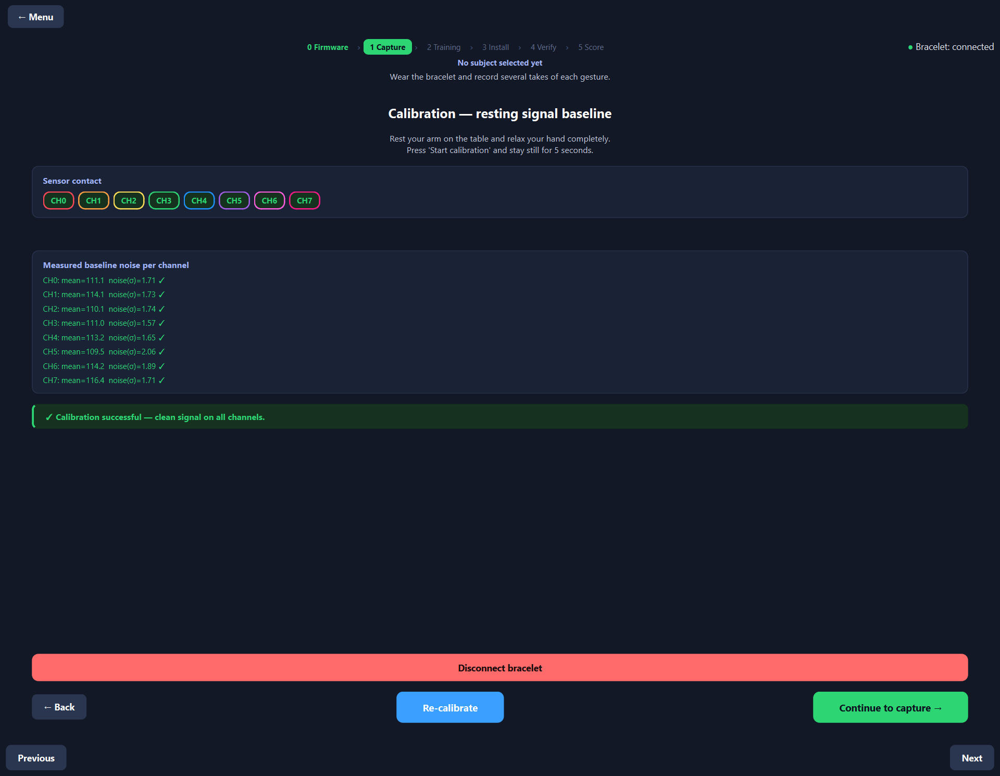

8개 채널 모두 `✓`이고, Sensor contact 칩이 모두 초록이며, 아래에 `✓ Calibration successful — clean signal on all channels.`가 나옵니다. 이 상태에서 **Continue to capture →**를 눌러 녹화 화면으로 넘어갑니다.

결과 상자별로 정리하면 다음과 같습니다.

| 결과 상자 | 할 일 |
|---|---|
| 초록: `✓ Calibration successful — clean signal on all channels.` | **Continue to capture →** |
| 노랑: `N channel(s) slightly noisy — you can continue or readjust the bracelet and re-calibrate.` (잡음 채널 1~2개) | 버튼은 눌리지만 넘어가지 마세요. 팔찌를 다시 차고 안정시킨 뒤 **Re-calibrate**해서 초록이 나오면 넘어갑니다. |
| 빨강: `N noisy channels — readjust the bracelet and re-calibrate.` (잡음 채널 3개 이상) | **Continue to capture →가 눌리지 않습니다.** 팔찌를 다시 차고 **Re-calibrate** |
| 빨강: `No data received. Check the connection and try again.` | 신호를 받지 못함. 연결을 확인하고 다시 측정 |

> 팔찌를 연결하지 않고 Start calibration을 누르면 `Connect the bracelet before running calibration.` 경고가 뜹니다.

#### ③ 녹화 화면

캘리브레이션에서 팔찌를 연결했으므로 녹화 화면에 들어오면 아래처럼 연결된 상태로 보입니다.

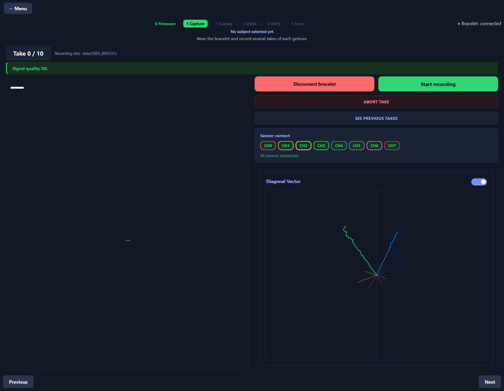

- 오른쪽 위 `● Bracelet: connected`, 연결 버튼은 빨간 **Disconnect bracelet**
- 위쪽 신호 품질 상자에 `Signal quality OK.`(초록): 잡음 없이 신호가 깨끗하게 들어오고 있습니다.
- 오른쪽 **Sensor contact**의 `CH0`~`CH7` 칩 글씨가 모두 초록이고, 그 아래 `All sensors connected.`: 센서 8개가 모두 피부에 잘 닿아 있습니다. 떨어진 센서가 있으면 그 칩이 빨강이 되고 `Not connected: CH3 - check electrode contact.`처럼 알려 줍니다.
- `Take 0 / 10` 옆에 저장될 위치(`Recording into data/S003_BATCH1/`)
- **이 세 가지가 모두 초록일 때 Start recording을 누릅니다.**

**Start recording을 누르면**

녹화가 시작되고 화면이 아래처럼 바뀝니다.

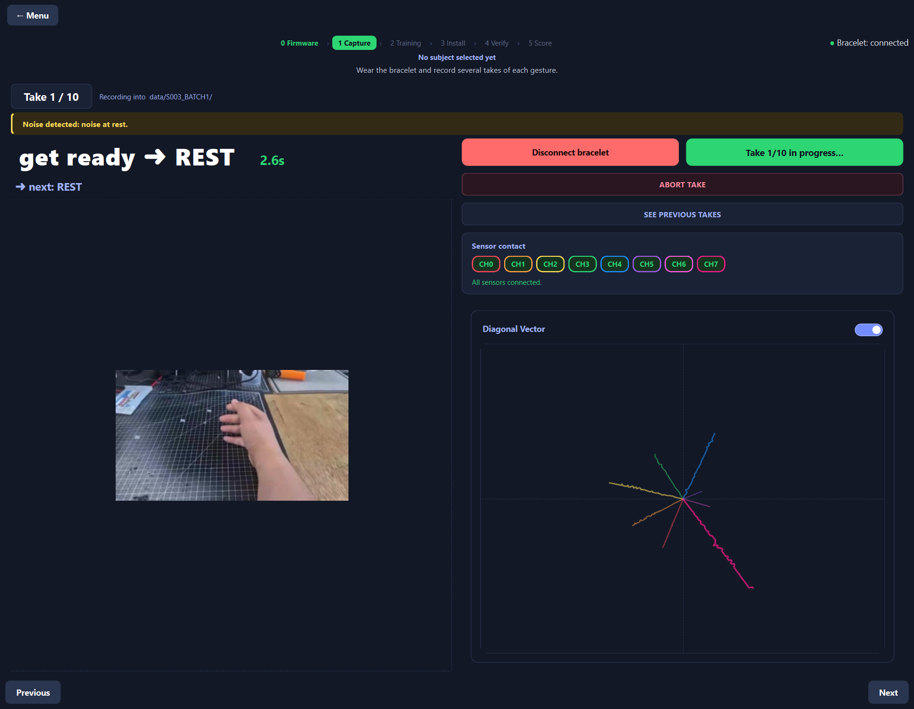

- 숫자가 `Take 1 / 10`이 되고, 버튼은 `Take 1/10 in progress…`로 바뀌어 녹화가 끝날 때까지 눌리지 않습니다.
- 처음 5초는 쉬기 구간입니다. `get ready ➜ REST`와 남은 시간(`2.6s`), 시연 영상으로 첫 동작을 미리 보여 줍니다.
- 위 화면처럼 쉬는 중에 `Noise detected: noise at rest.`(노랑)가 뜨면, 쉬는 구간 신호가 조금 큰 것입니다. 녹화는 계속되니 팔과 손가락 힘을 더 빼 주세요. 빨강(`Heavy noise ...`)은 잡음이 많다는 경고입니다. 경고가 잠깐 떴다 사라지면 그대로 진행해도 되고, 자주 뜨거나 오래 이어져 신호 품질이 좋지 않다고 판단되면 **ABORT TAKE**로 멈추고 다시 녹화할 수 있습니다.

화면의 각 부분은 다음과 같습니다.

| 화면 요소 | 설명 |
|---|---|
| **Take N / 10** (왼쪽 위) | 이번 세션에서 몇 번째 녹화(take)인지 보여 줍니다. 한 세션은 10 take입니다. |
| 신호 품질 상자 | 녹화 중 신호 상태를 알려 줍니다. 녹화 전에는 `Signal quality will appear here during recording.` |
| 동작 안내 (왼쪽) | 녹화 중에는 지금 할 동작 이름(예: `FLEXION`), 남은 시간, 다음 동작(`➜ next: ...`), 시연 영상이 나옵니다. 녹화 전에는 비어 있는 것이 정상입니다. |
| **Disconnect bracelet** | 팔찌 연결을 끊습니다. 끊긴 상태에서는 파란 **Connect bracelet**으로 바뀌고, 누르면 다시 연결합니다. |
| **Start recording** | 녹화 세션(10 take)을 시작합니다. 녹화 중에는 `Take 3/10 in progress…`처럼 바뀌고, take가 끝나면 `Next take (4/10)`로 바뀝니다. |
| **ABORT TAKE** | 지금 녹화 중인 take를 바로 멈추고 버립니다. 동작을 틀렸을 때 씁니다. 같은 번호로 다시 녹화합니다. |
| **SEE PREVIOUS TAKES** | 이번 묶음에서 녹화한 take 목록을 엽니다. 눌러서 그래프를 보거나 지울 수 있습니다. |
| **Sensor contact** | 녹화 중 채널별 접촉 상태입니다. 빨간 칩이 생기면 `Not connected: CH3 - check electrode contact.`처럼 알려 줍니다. |
| **Diagonal Vector** | 8개 채널 신호를 한눈에 보는 그래프입니다. 오른쪽 스위치로 끄고 켤 수 있습니다(끄면 PC 부담이 줄어듭니다). |

**한 take의 진행**

Start recording을 누르면 화면 지시에 따라 아래 순서가 자동으로 진행됩니다. 동작 순서는 take마다 무작위로 섞입니다.

```
쉬기 5초 → 동작 10초 → 쉬기 5초 → 동작 10초 → … → 마지막 동작 10초
```

- 6동작 기준 한 take는 약 1분 30초입니다.

화면은 **쉬는 시간**과 **동작하는 시간**, 두 가지가 번갈아 나옵니다.

**① 쉬는 시간: 다음 동작을 미리 알려 주는 화면**

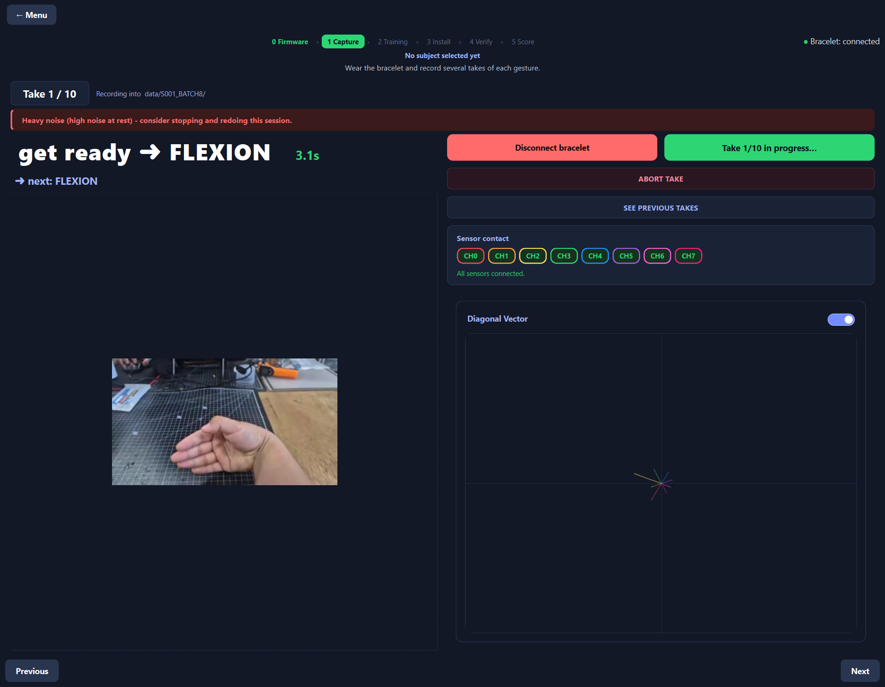

- 큰 글씨가 `get ready ➜ FLEXION`처럼 나오고, 시연 영상은 **다음에 할 동작**을 보여 줍니다.
- 이 시간에는 **아직 동작하지 않습니다.** 팔과 손가락 힘을 완전히 빼고, 영상을 보며 다음 동작을 준비합니다.
- 옆의 숫자(`3.1s`)는 쉬는 시간이 몇 초 남았는지입니다.
- 위 화면처럼 쉬는 중에 신호 품질 상자가 빨강(`Heavy noise (high noise at rest)`)이면 쉬는 동안 힘이 들어가 있다는 뜻입니다. 힘을 더 빼 주세요. 경고가 자주 뜨거나 오래 이어져 신호 품질이 좋지 않다고 판단되면 **ABORT TAKE**로 멈추고 다시 녹화할 수 있습니다.

**② 동작하는 시간: 실제로 해야 하는 화면**

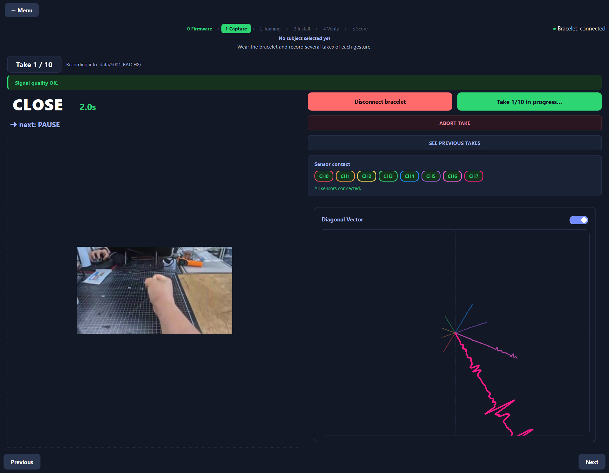

- 큰 글씨가 동작 이름만(`CLOSE`) 나오면 **그 순간부터 바로 동작합니다.**
- **이 화면이 뜨는 순간부터 녹화되는 신호에 그 동작 이름(정답 라벨)이 붙습니다.** 늦게 시작하거나 중간에 힘을 풀면, 동작하지 않은 신호에 동작 이름이 붙어 모델이 잘못 배웁니다. 남은 시간(`2.0s`)이 0이 될 때까지 같은 자세와 힘을 끝까지 유지하세요.
- `➜ next: PAUSE`는 이 동작이 끝나면 다시 쉬는 시간이라는 뜻입니다.
- 신호 품질 `Signal quality OK.`, Sensor contact `All sensors connected.`가 초록이면 정상입니다.

**take가 끝나면**

1. 방금 녹화한 take의 결과 창(`Last take — 파일 이름`)이 자동으로 열립니다.

   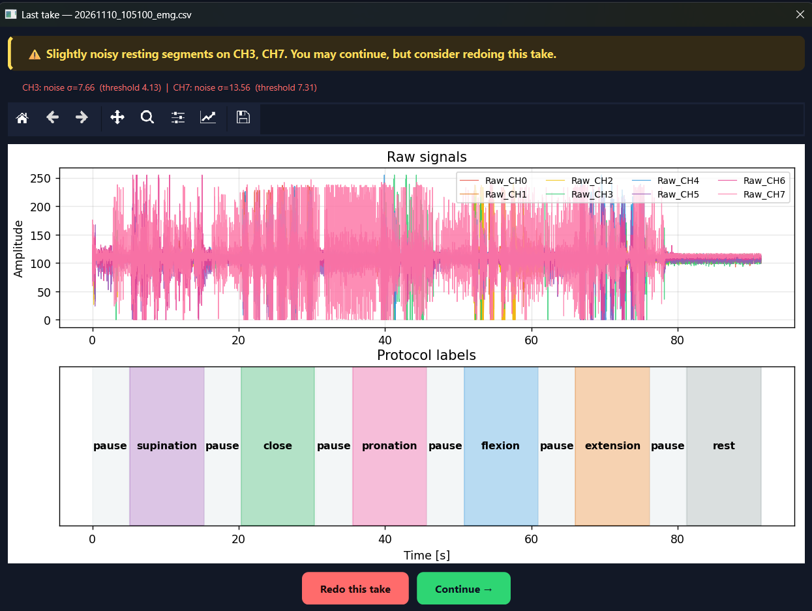

   - **Raw signals:** 8개 채널 신호입니다. 동작 구간에서는 크게 흔들리고, 쉬는 구간에서는 작고 고르게 돌아와야 좋은 take입니다.
   - **Protocol labels:** 각 시간에 붙은 정답 라벨입니다. 위 신호와 시간이 맞춰져 있어, 동작 구간(색 칸)에서 실제로 신호가 커졌는지 비교할 수 있습니다.
   - 맨 위 상자: 잡음 판정입니다. 위 화면은 `Slightly noisy resting segments on CH3, CH7. You may continue, but consider redoing this take.`로, CH3·CH7이 쉬는 구간에서 기준(캘리브레이션 값)보다 흔들렸다는 뜻입니다. 그 아래 빨간 줄에 채널별 잡음 크기와 기준값이 나옵니다.
   - 맨 위 상자의 판정은 세 가지입니다. 쉬는 구간의 잡음을 캘리브레이션 때 잰 기준값과 채널별로 비교해 정합니다.

     | 판정 | 뜻 |
     |---|---|
     | 초록 `✓ Good take — resting noise within the personal baseline.` | 모든 채널이 기준 안. 좋은 take입니다. |
     | 노랑 `⚠ Slightly noisy resting segments on ...` | 일부 채널만 쉬는 구간에서 기준보다 흔들림 (위 화면) |
     | 빨강 `✗ Too much noise during rest on ... Please redo this recording.` | 많은 채널이 쉬는 구간에서 기준을 크게 넘음 (아래 화면) |

     **잡음이 너무 많을 때의 예**

     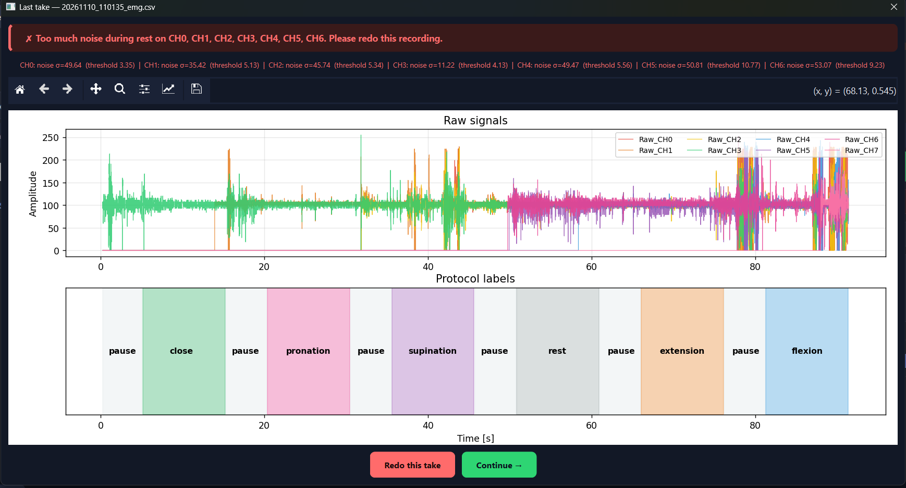

     CH0~CH6 일곱 채널이 쉬는 구간에서 기준을 크게 넘었습니다(예: CH0 잡음 49.64, 기준 3.35). 그래프에서도 `pause`·`rest` 구간 신호가 조용히 가라앉지 않고 계속 크게 흔들립니다. 이런 take로 학습하면 모델이 쉬는 상태와 동작을 잘 구분하지 못하므로, 팔찌를 다시 차고 힘을 뺀 상태를 확인한 뒤 **Redo this take**로 다시 녹화하는 것이 좋습니다.

2. 판정을 보고 고릅니다.
   - **Continue →**: 이 take를 저장하고 다음 take로 갑니다. 경고가 없으면 이 버튼을 누릅니다.
   - **Redo this take**: 이 take를 지우고 같은 번호로 다시 녹화합니다. 경고가 떴더라도 꼭 다시 할 필요는 없습니다. 그래프를 보고 잡음이 많아 신호 품질이 좋지 않다고 판단되면 다시 녹화하세요.
3. 버튼이 **Next take (N/10)**으로 바뀝니다. 준비되면 눌러 다음 take를 시작합니다. 쉬고 싶으면 잠시 쉬었다 눌러도 됩니다.
4. 10 take를 모두 마치면 아래 창이 뜹니다. 저장 위치를 확인하고 **OK**를 누른 뒤, 화면 아래 **Next**로 Phase 2에 갑니다.

   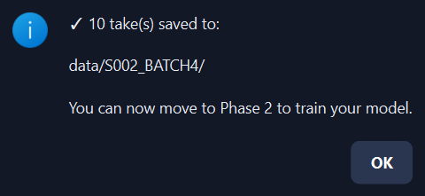

**신호 품질 상자의 경고**

| 경고 | 뜻 | 할 일 |
|---|---|---|
| `Signal quality OK.` (초록) | 정상 | 그대로 진행 |
| `Noise detected: some clipping.` (노랑) | 신호가 측정 범위 끝(0 또는 255)에 가끔 닿음 | 지켜보며 진행 |
| `Noise detected: noise at rest.` (노랑) | 쉬는 구간인데 신호가 조금 큼 | 쉴 때 힘을 더 빼기 |
| `Heavy noise (saturation) - consider stopping and redoing this session.` (빨강) | 신호가 범위 끝에 자주 붙음 | 자주 뜨거나 오래 이어지면 ABORT TAKE로 멈추고 팔찌를 다시 찬 뒤 재녹화할 수 있음 |
| `Heavy noise (high noise at rest) - ...` (빨강) | 쉬는 구간 신호가 큼 | 팔 힘을 더 빼기. 자주 뜨거나 오래 이어지면 팔찌를 다시 찬 뒤 재녹화할 수 있음 |

---

### 3.4 Phase 2. Training — 모델 학습

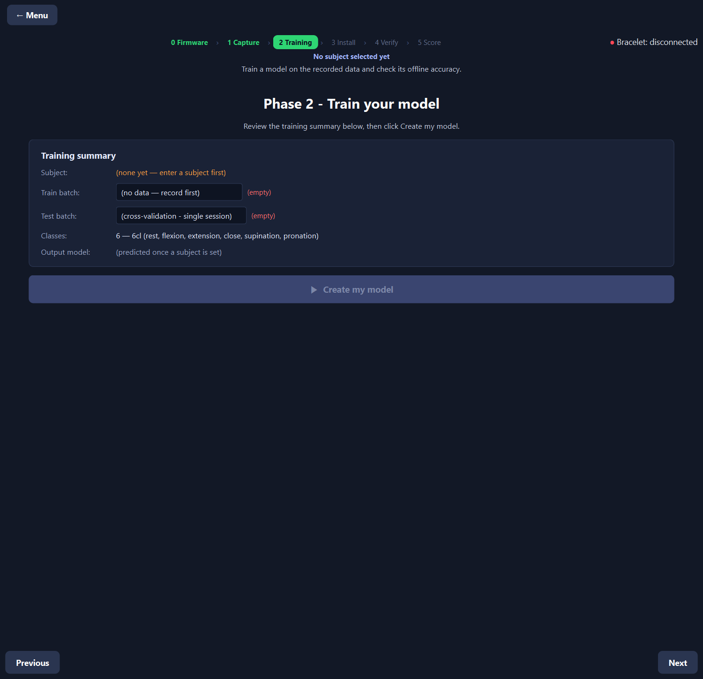

녹화한 데이터로 이 사람만의 모델을 만듭니다. Phase 1에서 피험자를 정하면 아래처럼 내용이 채워집니다.

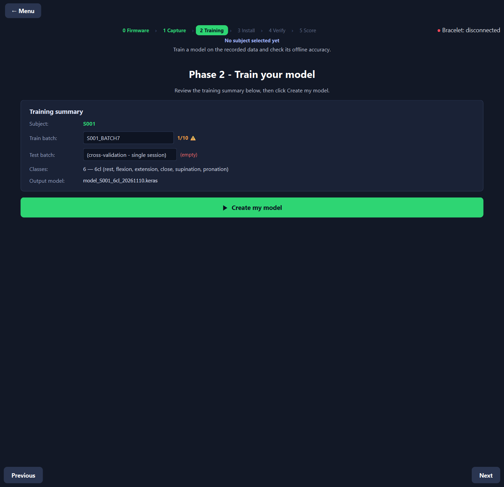

**Training summary**

| 항목 | 설명 |
|---|---|
| **Subject** | 학습할 피험자 ID. 비어 있으면 `(none yet — enter a subject first)`. Phase 1에서 피험자를 먼저 정하세요. |
| **Train batch** | 학습에 쓸 녹화 묶음(예: `S001_BATCH7`). 오른쪽 숫자는 그 묶음의 take 수입니다. `10/10 ✓`이면 충분하고, `1/10 ⚠`처럼 10개보다 적으면 정확도가 떨어질 수 있습니다. |
| **Test batch** | 정확도를 잴 데이터입니다. 기본값 `(cross-validation - single session)`은 Train batch 안에서 나눠 평가합니다. 다른 묶음을 고르면 그 묶음으로 평가합니다. |
| **Classes** | 학습할 동작 수와 목록. Train batch의 녹화 내용에서 자동으로 정해집니다. |
| **Output model** | 만들어질 모델 파일 이름. 예: `model_S001_6cl_20261110.keras` |

**순서**

1. Train batch가 방금 녹화한 묶음인지 확인합니다.
2. Test batch는 보통 기본값(cross-validation)으로 둡니다.
3. **▶ Create my model**을 누릅니다. 진행 막대가 나오고 몇 분 걸립니다.
4. 끝나면 `Training complete`와 정확도(`Accuracy: 92.90%`)가 나옵니다.
5. **Next**를 누르면 방금 만든 모델이 Phase 3에 자동으로 선택됩니다.

**학습이 끝난 화면**

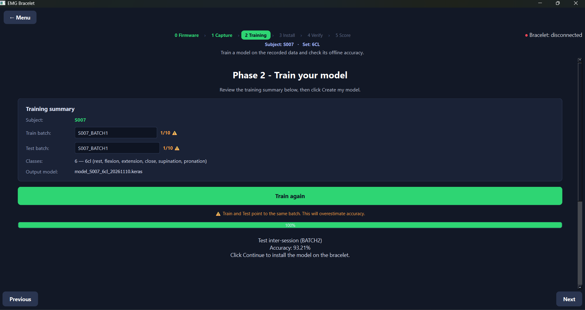

- `Training complete`와 진행 막대 100%가 나오고, 그 아래에 정확도(`Accuracy: 93.21%`)가 나옵니다.
- Train과 Test에 같은 묶음을 넣으면 주황색으로 `⚠ Train and Test point to the same batch. This will overestimate accuracy.`가 함께 나옵니다. 정확도가 실제보다 높게 나온다는 경고입니다.
- 버튼은 **Train again**으로 바뀝니다. 다른 묶음으로 다시 학습하고 싶을 때 누릅니다.
- 결과가 괜찮으면 **Next**를 눌러 Phase 3으로 갑니다.

> 위 화면은 기능 확인용으로 찍은 것이라 take 1개짜리 묶음(`S007_BATCH1`, `1/10 ⚠`)을 Train과 Test에 똑같이 넣었습니다. 실제로 사용할 때는 이렇게 하면 안 됩니다.
> - **Train batch**에는 10 take를 끝까지 녹화한 묶음(`10/10 ✓`)을 넣어야 합니다. take가 적으면 모델이 그날 한 번의 동작만 외워서 실제로 찼을 때 잘 맞히지 못합니다.
> - **Test batch**에는 Train과 **다른 묶음**(가능하면 다른 날, 팔찌를 새로 차고 녹화한 묶음)을 넣거나, 묶음이 하나뿐이면 기본값 `(cross-validation - single session)`을 둡니다. 학습한 데이터로 다시 시험하면 정답을 보고 푼 것과 같아서 정확도가 실제보다 높게 나옵니다. 이때 앱이 `Same batch for train and test` 확인 창을 띄웁니다.
> - 결과 문구의 `Test inter-session (BATCH2)`는 고정된 제목입니다. 실제로 평가에 쓴 묶음은 화면 위쪽 **Test batch** 칸에 나온 묶음입니다.

**확인 창**

| 창 | 뜻 |
|---|---|
| `Missing data` | Train batch를 고르지 않음 |
| `Empty train batch` / `Empty test batch` | 고른 묶음에 녹화 파일이 없음 |
| `Gestures missing from the recording` | 고른 묶음에 아예 녹화되지 않은 동작이 있음(예: take를 도중에 멈춤). 모델이 그 동작을 배울 수 없어 학습을 시작하지 않습니다. 창에 빠진 동작 이름이 나오니, Phase 1에서 끝까지 녹화하거나 모든 동작이 들어 있는 다른 묶음을 고르세요. |
| `Same batch for train and test` | Train과 Test에 같은 묶음을 고름. 정확도가 실제보다 높게 나오므로 cross-validation을 권장 |

결과가 마음에 들지 않으면 버튼이 **Train again**으로 바뀌어 있으니 다시 학습할 수 있습니다. 실패하면 `Training failed`와 오류가 나오고 **Retry**로 다시 시도합니다.

> 정확도가 낮다면: 동작을 서로 더 확실히 구분되게, 매번 같은 세기로 다시 녹화하는 것이 가장 효과적입니다.

---

### 3.5 Phase 3. Install — 팔찌에 모델 설치

만든 모델을 팔찌에 넣습니다. 설치 방법은 두 가지입니다.

| 화면 요소 | 설명 |
|---|---|
| **Selected model** | 설치할 모델. Phase 2를 마쳤거나 Load an old session에서 골랐으면 자동으로 채워집니다. 비어 있으면 `(none — pick one from the Load screen first)`. |
| **Detected port** / **Refresh** | USB로 연결된 팔찌 포트. Phase 0과 같습니다. |
| **▶ Install on bracelet** | **USB로** 펌웨어와 모델을 함께 설치합니다. Arduino IDE를 열 필요가 없습니다. |
| **Choose bracelet** | 주변에 팔찌가 여러 개일 때 어느 팔찌로 보낼지 고릅니다([9절](#9-팔찌-선택-창-choose-bracelet)). |
| **📡 Send weights over BLE (no reflash)** | **무선으로** 모델 값만 보냅니다. USB 케이블이 필요 없고 더 빠릅니다. |
| 진행 막대와 로그 창 | 설치 진행 상황과 메시지 |
| **Continue →** | 설치가 끝나면 나타납니다. 누르면 Phase 4로 갑니다. |

**BLE로 보내는 과정**

**📡 Send weights over BLE**를 누르면 버튼이 `⏳ Sending over BLE...`로 바뀌고, 로그 창에 진행 상황이 나옵니다.

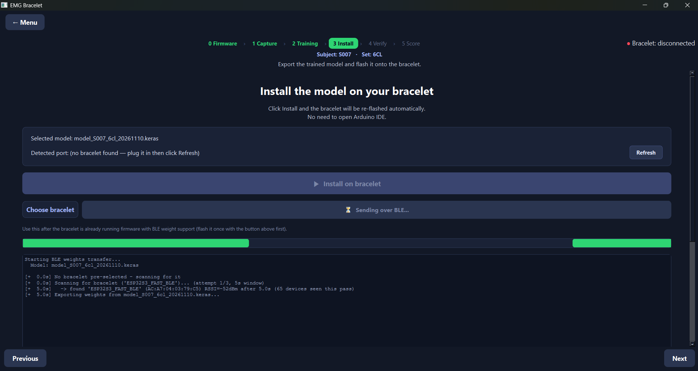

1. `Scanning for bracelet ('ESP32S3_FAST_BLE')...`: 주변에서 팔찌를 찾습니다. 찾으면 `-> found 'ESP32S3_FAST_BLE' (주소) RSSI=-52dBm`처럼 나옵니다. 팔찌를 미리 고르지 않았으면 이름이 맞는 팔찌를 자동으로 찾습니다.
2. `Exporting weights from model_....keras...`: 모델을 팔찌에 보낼 형태로 바꿉니다. 몇 초 걸립니다.
3. `Connecting to ...` → `Connected`: 팔찌와 연결합니다.
4. `Sending 53316 bytes in 244-byte chunks...`: 모델을 나눠서 보냅니다. 퍼센트(9% → 100%)가 올라갑니다. 30초쯤 걸리니 팔찌를 PC 가까이 두고 기다리세요.

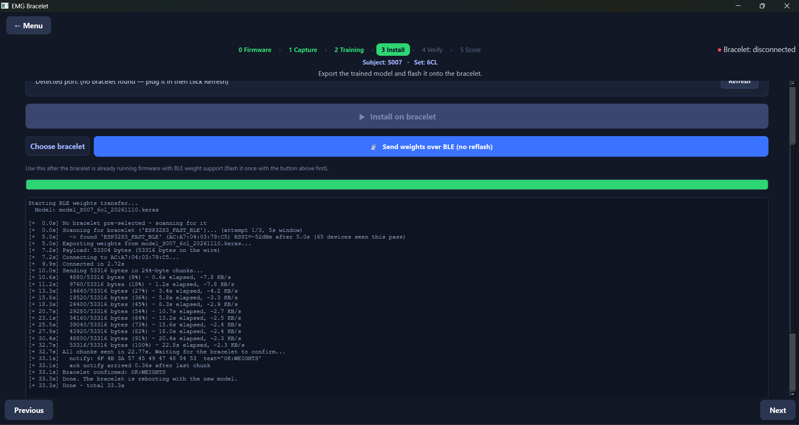

5. `Bracelet confirmed: OK:WEIGHTS`: 팔찌가 모델을 잘 받았다고 답한 것입니다.
6. `Done. The bracelet is rebooting with the new model.`: 팔찌가 새 모델로 다시 시작합니다. 진행 막대가 끝까지 초록이 되면 끝입니다.

전송이 끝나면 **Next**를 눌러 Phase 4로 갑니다.

> 화면 위쪽의 `Detected port: (no bracelet found ...)`와 오른쪽 위 `● Bracelet: disconnected`는 USB 연결과 녹화용 연결 상태입니다. BLE로 보낼 때는 USB가 필요 없으므로 이렇게 나와도 정상입니다.

**어느 방법을 쓰나**

- **처음 설치하거나, BLE 전송이 안 될 때:** USB를 꽂고 **▶ Install on bracelet**. 버튼이 `⏳ Installing... do not unplug`으로 바뀌는 동안 케이블을 뽑지 마세요.
- **이미 한 번 USB로 설치한 팔찌에 새 모델만 바꿔 넣을 때:** **📡 Send weights over BLE**. 화면 안내대로, 팔찌가 BLE 모델 전송을 지원하는 펌웨어로 한 번은 USB 설치되어 있어야 합니다.

> BLE 전송에서 `Characteristic ... not found` 오류가 나면 팔찌에 예전 펌웨어가 들어 있는 것입니다. USB로 **Install on bracelet**을 한 번 하세요.

---

### 3.6 Phase 4. Verify — 실시간 확인

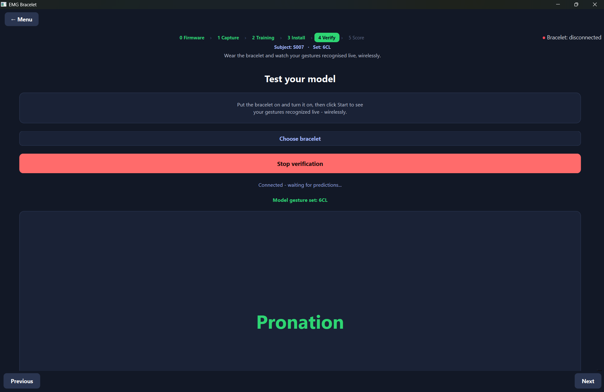

팔찌가 동작을 제대로 알아보는지 눈으로 확인합니다. 이 단계부터 팔찌가 **스스로** 동작을 판단하고, PC는 결과만 무선으로 받아 보여 줍니다.

| 화면 요소 | 설명 |
|---|---|
| **Choose bracelet** | 연결할 팔찌를 고릅니다. 하나뿐이면 누르지 않아도 됩니다. |
| **Start verification** | 팔찌에 연결해 인식 결과를 받기 시작합니다. 누르면 **Stop verification**으로 바뀝니다. |
| 상태 줄 | `Ready` → `Starting BLE scan...` → `Connected - waiting for predictions...`. 멈추면 `Stopped`, 실패하면 `Failed: ...` |
| **Model gesture set** (초록 글씨) | 팔찌에 들어 있는 모델이 알아보는 동작 묶음입니다. 예: `6CL`이면 6동작 모델 |
| 결과 상자 (아래) | 팔찌가 지금 인식한 동작 이름이 초록 큰 글씨로 실시간으로 나옵니다(위 화면은 `Pronation`). |

**순서**

1. 모델이 설치된 팔찌를 차고 전원을 켭니다.
2. **Start verification**을 누릅니다.
3. 동작을 하나씩 해 보며 화면의 동작 이름이 맞게 바뀌는지 봅니다.
4. 다 봤으면 **Stop verification**을 누르고 **Next**로 넘어갑니다.

---

### 3.7 Phase 5. Score — 온라인 점수 측정

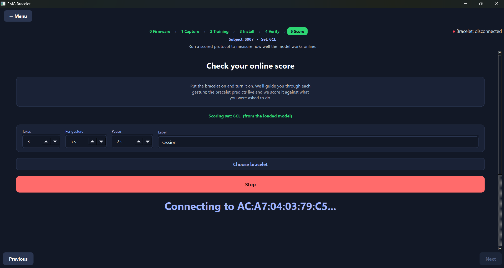

화면이 시키는 동작을 따라 하면, 팔찌가 인식한 결과와 비교해 실제 정확도를 점수로 냅니다. Phase 2의 정확도는 녹화 데이터로 잰 값이고, 이 점수는 **실제로 차고 쓸 때**의 정확도입니다.

**설정 줄**

| 항목 | 설명 | 기본값 |
|---|---|---|
| **Scoring set** (초록 글씨) | 채점할 동작 묶음. 불러온 모델에서 자동으로 정해집니다(`6CL (from the loaded model)`). 모델을 고르지 않았을 때만 그 자리에 **Classes** 선택 칸이 나옵니다. | 모델에 따라 |
| **Takes** | 전체 동작 묶음을 몇 번 반복할지 | 3 |
| **Per gesture** | 동작 하나를 유지하는 시간 | 5 s |
| **Pause** | 동작 사이 쉬는 시간 | 2 s |
| **Label** | 결과 파일 이름에 붙일 이름 | session |

**순서**

1. **Start verification**을 누릅니다. 버튼이 빨간 **Stop**으로 바뀌고, 큰 글씨로 `Scanning for bracelet... (attempt 1/3)` → `Connecting to (팔찌 주소)...` 순서로 팔찌를 찾아 연결합니다(맨 위 화면). 연결되면 측정이 바로 시작됩니다.
2. 동작마다 아래 순서로 진행됩니다.
   - **준비(노랑 글씨):** `Take 1/3 - get ready - 2s`. 동작 이름과 시연 영상을 보고 준비합니다.
   - **측정(초록 글씨):** `Take 1/3 - RECORDING - 4s - 37 preds (92% match)`. 동작을 유지합니다. 지금까지 받은 인식 결과 수와 일치율이 나옵니다.
   - **쉬기(파랑 글씨 REST):** `Pause - 2s`. 힘을 뺍니다.

   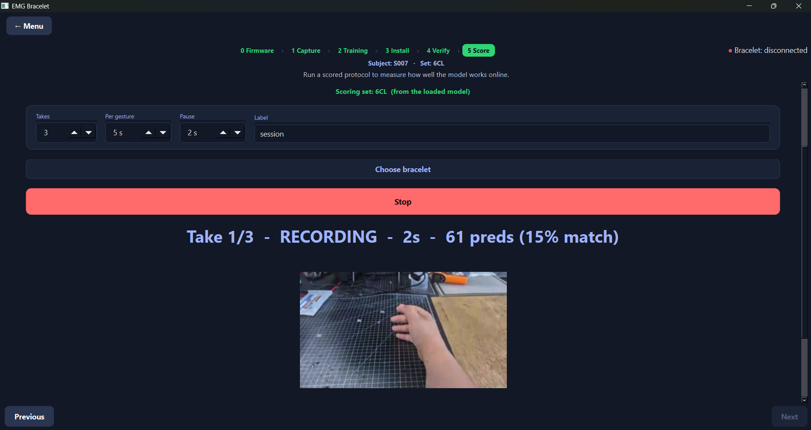

   위 화면은 측정 중인 모습입니다. `Take 1/3 - RECORDING - 2s - 61 preds (15% match)`는 첫 번째 반복의 측정 구간이고, 2초 남았으며, 지금까지 팔찌가 보낸 인식 결과 61개 중 15%가 화면 동작과 일치했다는 뜻입니다. 아래 시연 영상과 같은 동작을 유지하세요.

3. 끝나면 결과가 나옵니다.

```
Overall live accuracy (raw, no smoothing): 91.4%
412/451 predictions matched
Macro-F1: 0.912
Gesture set: 6cl

  close      :  95.0%   (76/80)
  extension  :  88.2%   (67/76)
  ...
Saved: benchmarks/live_session.csv
```

- **Overall live accuracy:** 전체 인식 결과 중 맞은 비율
- **Macro-F1:** 동작별 성능을 고르게 반영한 점수 (1에 가까울수록 좋음)
- 동작별 줄: 어떤 동작을 잘 못 알아보는지 확인할 수 있습니다.
- 이 점수는 Load an old session의 **Online** 칸에도 저장됩니다.

`Finished - no predictions received`가 나오면 팔찌에서 결과를 하나도 받지 못한 것입니다. 모델이 설치되어 있는지, 팔찌가 켜져 있는지 확인하세요.

---

## 4. Load an old session: 예전 모델 불러오기

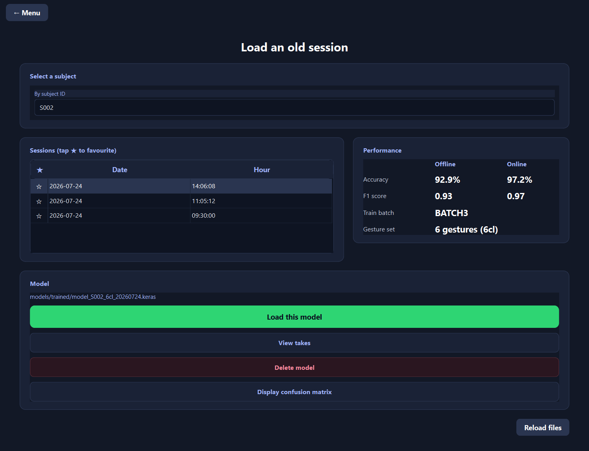

예전에 학습한 모델을 골라 다시 팔찌에 설치하거나, 성능을 확인합니다.

| 화면 요소 | 설명 |
|---|---|
| **Select a subject** | 피험자 ID를 고릅니다. |
| **Sessions** | 그 피험자가 학습한 기록(날짜·시간)입니다. 최근 것이 위에 있습니다. 줄을 누르면 오른쪽과 아래에 정보가 나옵니다. **☆**을 누르면 즐겨찾기(★)가 되어 맨 위로 올라갑니다. |
| **Performance** | 고른 모델의 성능입니다. |
| ┗ **Offline** | Phase 2 학습 때 잰 정확도(Accuracy)와 F1 점수 |
| ┗ **Online** | Phase 5에서 실제로 차고 잰 정확도와 F1 점수. 측정하지 않았으면 `-` |
| ┗ **Train batch** | 학습에 쓴 녹화 묶음 |
| ┗ **Gesture set** | 동작 묶음 (6 gestures 등) |
| **Model** | 모델 파일 위치 (예: `models/trained/model_S002_6cl_20260724.keras`) |
| **Load this model** | 아래 [버튼별 사용법](#버튼별-사용법) 참고 |
| **View takes** | 아래 [버튼별 사용법](#버튼별-사용법) 참고 |
| **Delete model** | 아래 [버튼별 사용법](#버튼별-사용법) 참고 |
| **Display confusion matrix** | 아래 [버튼별 사용법](#버튼별-사용법) 참고 |
| **Reload files** | 목록을 다시 읽어 옵니다. |

### 버튼별 사용법

먼저 **Select a subject**에서 피험자를 고르고, **Sessions**에서 세션 한 줄을 누릅니다. 세션을 고르지 않고 아래 버튼을 누르면 버튼 아래에 `Select a session first.`가 나옵니다.

#### Load this model: 예전 모델을 팔찌에 다시 넣기

- 누르면 **New subject 작업 화면의 Phase 3(Install)로 바로 이동**합니다. 이 세션의 모델이 `Selected model`에 이미 들어가 있습니다.
- 다시 녹화하거나 학습할 필요 없이, [3.5절](#35-phase-3-install--팔찌에-모델-설치)처럼 **Install on bracelet**(USB) 또는 **Send weights over BLE**(무선)로 바로 설치하면 됩니다.
- 이 세션과 연결된 상태라, 이어서 Phase 5에서 점수를 재면 결과가 이 세션의 **Online** 칸에 저장됩니다.
- 언제 쓰나: 팔찌를 다른 사람이 쓰다가 돌려받았을 때, 새로 만든 모델보다 예전 모델이 더 좋았을 때

#### View takes: 이 모델을 학습한 녹화 보기

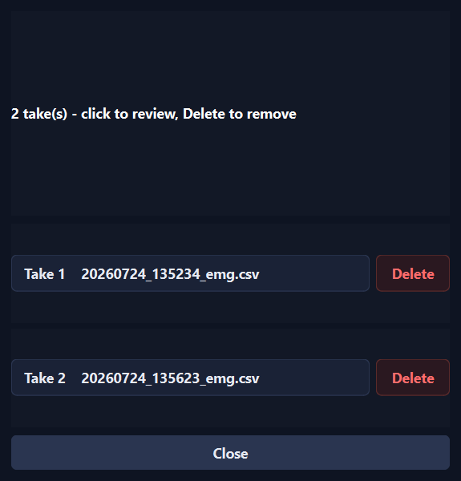

- 누르면 `Session takes` 창이 열리고, 이 모델을 학습할 때 쓴 녹화 묶음의 take 목록이 나옵니다(`N take(s) - click to review, Delete to remove`).
- **Take N (파일 이름)** 을 누르면 그 take의 신호 그래프 창이 열립니다([5절 take 뷰어](#take-뷰어)와 같은 화면). 동작 구간에서 신호가 제대로 커졌는지, 쉬는 구간이 조용한지 확인할 수 있습니다.
- **Delete**를 누르면 `Delete this take permanently? ... This cannot be undone.` 확인 창이 뜨고, **Yes**를 누르면 그 take 파일이 지워지고 목록이 바로 갱신됩니다. 모델은 그대로 남습니다. 다음 학습부터 그 take가 빠집니다.
- 녹화 폴더가 없으면 버튼 아래에 `Takes folder not found: ...`, take가 하나도 없으면 `No takes found in ...`이 나옵니다.

#### Delete model: 학습 기록과 모델 지우기

- 누르면 확인 창이 뜹니다. 피험자, 날짜·시간, 모델 파일 이름과 함께 "학습 기록에서 이 줄을 지우고, 다른 세션이 같은 모델 파일을 쓰지 않으면 파일도 지운다. 되돌릴 수 없다"는 내용이 나옵니다.
- **Yes**를 누르면:
  - 이 세션 줄이 **Sessions** 목록에서 사라집니다.
  - 모델 파일(`.keras`)과 짝이 되는 스케일러 파일(`.pkl`)이 지워집니다. 같은 모델을 쓰는 다른 세션이 남아 있으면 파일은 지우지 않습니다.
  - 버튼 아래에 결과가 나옵니다. 예: `1 registry row removed. files deleted: model, scaler.`
- **녹화 데이터(take)는 지워지지 않습니다.** 같은 녹화로 다시 학습할 수 있습니다.
- **No**를 누르면 아무것도 바뀌지 않습니다.

#### Display confusion matrix: 어떤 동작을 헷갈리는지 보기

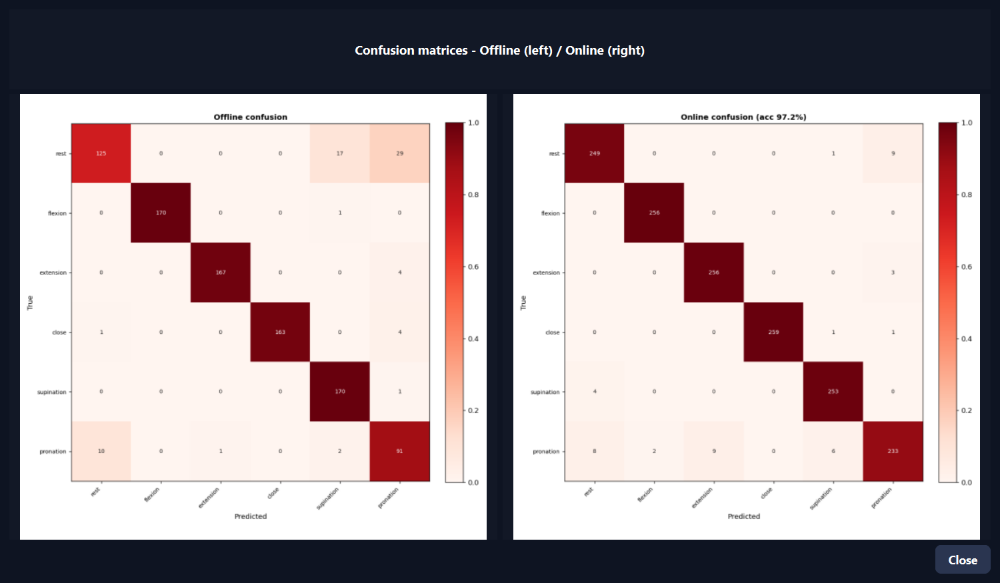

- 누르면 `Confusion matrices` 창이 열립니다. 왼쪽은 **Offline**(Phase 2 학습 때 결과), 오른쪽은 **Online**(Phase 5에서 실제로 차고 잰 결과)입니다. 오른쪽 제목에는 Online 정확도가 함께 나옵니다(예: `Online confusion (acc 16.6%)`).
- 읽는 법: 혼동 행렬은 "실제로 한 동작"과 "모델이 판단한 동작"을 짝지어 횟수를 센 표입니다.
  - **줄(세로, True)** 은 실제로 한 동작, **칸(가로, Predicted)** 은 모델이 판단한 동작, 칸 안 숫자는 그렇게 판단한 횟수입니다. 숫자가 클수록 색이 진합니다.
  - 왼쪽 위에서 오른쪽 아래로 이어지는 **대각선** 칸은 실제 동작과 판단이 같은, 즉 **맞힌** 횟수입니다. 이 칸들이 진할수록 좋은 모델입니다.
  - 대각선 밖 칸은 **틀린** 횟수입니다. 여기서 진한 칸을 찾으면 어떤 두 동작을 헷갈리는지 알 수 있습니다.

    | 실제 \ 판단 | rest | flexion | close |
    |---|---|---|---|
    | **rest** | **95** | 3 | 2 |
    | **flexion** | 4 | **60** | 36 |
    | **close** | 1 | 5 | **94** |

    위 예에서 대각선(95, 60, 94)이 맞힌 횟수입니다. flexion 줄의 close 칸(36)이 큰 것은, 손목을 굽혔는데 36번은 주먹 쥐기로 잘못 알아봤다는 뜻입니다. 이럴 때는 두 동작을 더 확실히 다르게 녹화하면 좋아집니다.
  - 설명서 그림의 오른쪽(Online)은 모든 줄에서 `supination` 칸만 진합니다. 어떤 동작을 해도 거의 다 supination으로 판단했다는 뜻이라, 모델이 동작을 구분하지 못하는 상태입니다. 다시 녹화하고 학습해야 합니다.
- 그림 대신 글자가 나오는 경우:
  - `Offline confusion not available for this model. Retrain to generate it.`: 예전 버전에서 학습한 모델이라 기록이 없습니다. 다시 학습하면 생깁니다.
  - `No online score found for this subject/set. Run Phase 5 first.`: 아직 Phase 5 점수를 재지 않았습니다.
- 창은 **Close**로 닫습니다.

---

## 5. Browse takes: 녹화본 둘러보기

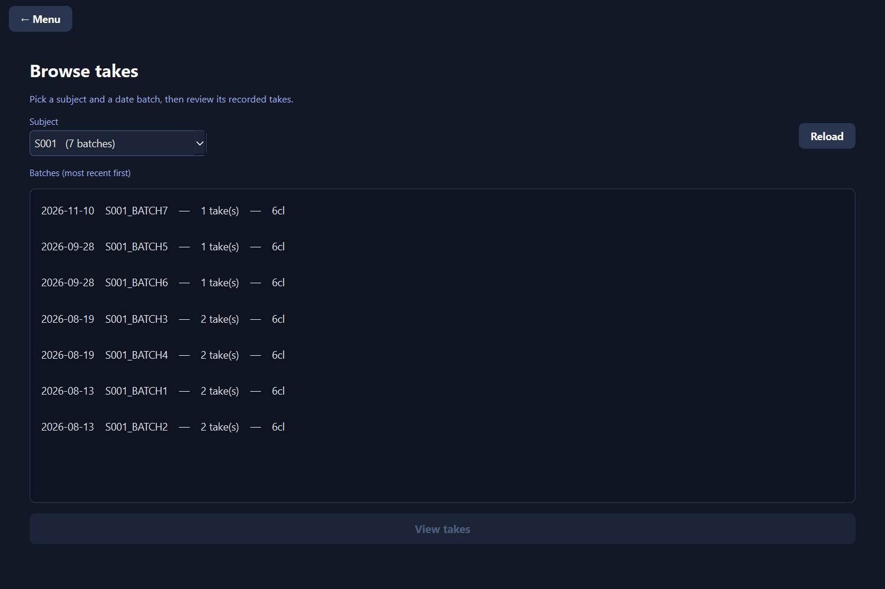

학습과 상관없이 녹화해 둔 모든 데이터를 피험자·묶음별로 봅니다.

| 화면 요소 | 설명 |
|---|---|
| **Subject** | 피험자를 고릅니다. 괄호 안은 녹화 묶음 수입니다. |
| **Batches** | 그 피험자의 녹화 묶음 목록(최근 순). `날짜 — 묶음 이름 — take 수 — 동작 묶음` |
| **View takes** | 묶음을 고르면 초록색으로 켜집니다. 누르면 take 목록이 열립니다. 목록을 두 번 눌러도 됩니다. |
| **Reload** | 목록을 다시 읽어 옵니다. |

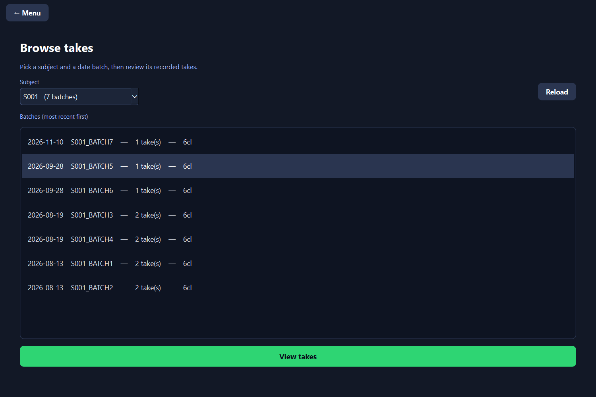

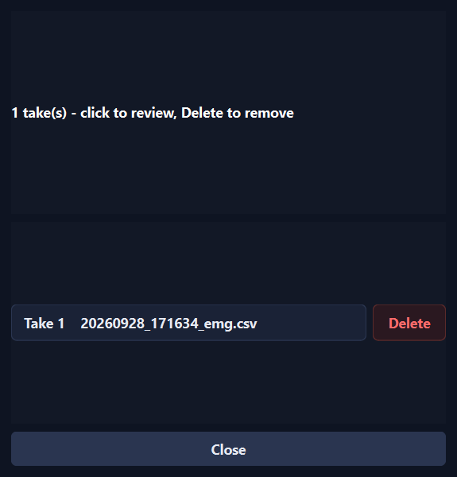

take 목록 창은 [4절의 View takes](#4-load-an-old-session-예전-모델-불러오기)와 같습니다. Take를 누르면 그래프, **Delete**는 삭제입니다.

#### take 뷰어

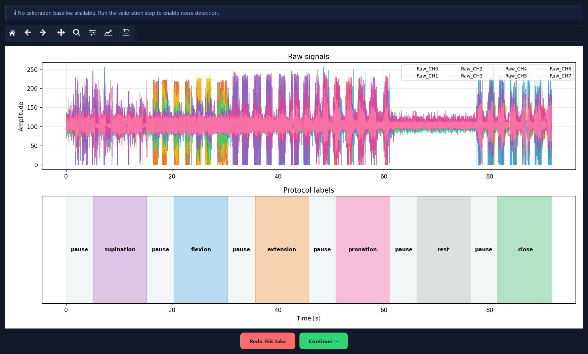

take 하나의 신호를 그래프로 보여 줍니다.

| 화면 요소 | 설명 |
|---|---|
| 맨 위 안내 상자 | 잡음 판정 결과입니다. 캘리브레이션 기준값이 없으면 `No calibration baseline available...`이 나옵니다(이 화면처럼 나중에 열어 볼 때). Phase 1 녹화 직후에는 잡음 판정이 나옵니다. |
| 도구 막대 | 🏠 처음 보기, ← → 이전·다음 보기, ✥ 끌어서 이동, 🔍 영역 확대, 여백 조정, 축 설정, 💾 그림 저장 |
| **Raw signals** | 8개 채널의 신호입니다. 가로는 시간(초), 세로는 신호 크기(0~255)입니다. |
| **Protocol labels** | 각 시간에 화면이 지시한 동작입니다. 위 그래프와 시간이 맞춰져 있습니다. |
| **Redo this take** / **Continue →** | Phase 1 녹화 직후에 쓰는 버튼입니다([3.3절](#-녹화-화면)). |

**좋은 take 고르는 법**

- 동작 구간(색 칸)에서는 신호가 커지고, `pause`·`rest` 구간에서는 작고 고르게 돌아와야 합니다.
- 어떤 동작 구간에서 신호가 쉬는 구간과 비슷하면, 그 동작을 제대로 하지 않았거나 센서가 떨어진 것입니다. 다시 녹화하세요.
- 신호가 0이나 250 근처에 계속 붙어 있으면 잡음(포화)입니다.

---

## 6. Subjects directory: 피험자 목록

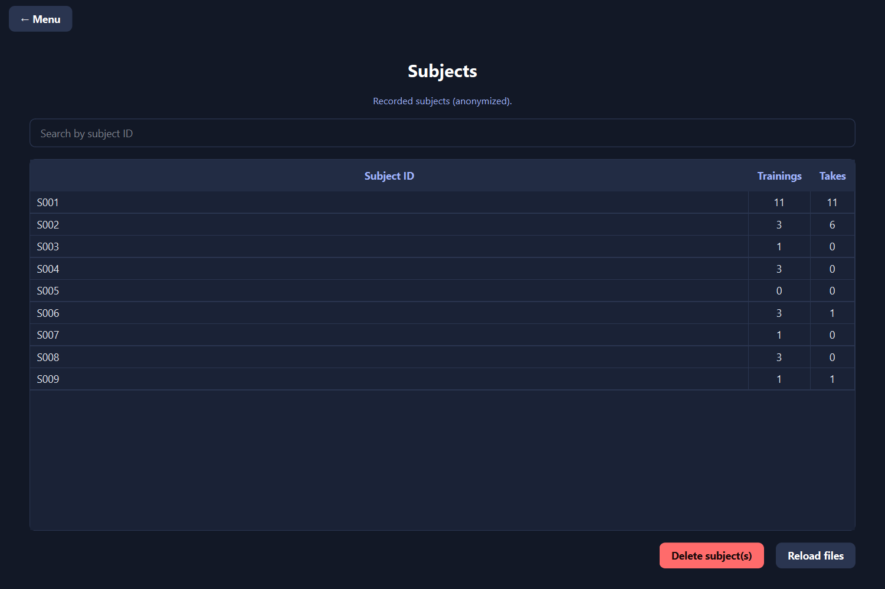

| 화면 요소 | 설명 |
|---|---|
| **Search by subject ID** | ID 일부를 입력해 걸러 봅니다. |
| **Subject ID** | 피험자 ID |
| **Trainings** | 그 피험자로 학습한 횟수 |
| **Takes** | 그 피험자의 녹화 take 수 |
| **Delete subject(s)** | 고른 피험자를 목록에서 지웁니다(여러 명을 골라 한 번에 지울 수 있음). **되돌릴 수 없습니다.** |
| **Reload files** | 목록을 다시 읽어 옵니다. |

---

## 7. Pair robotic hand: 의수 페어링

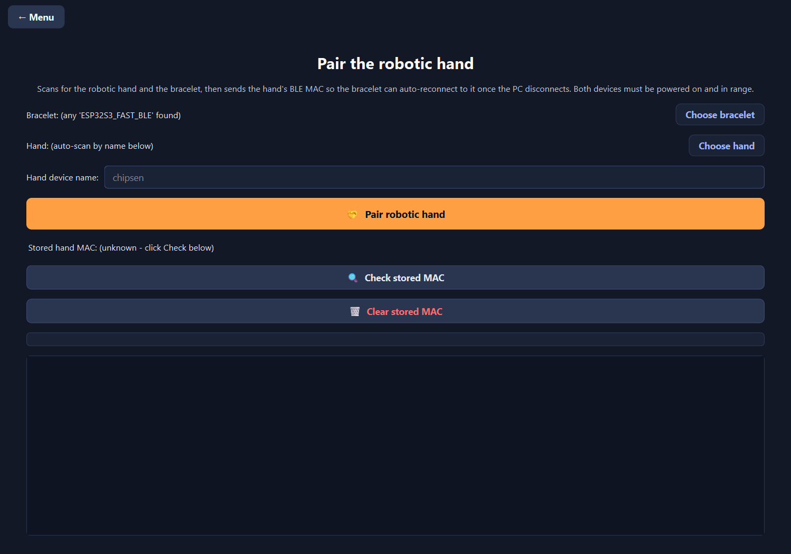

로봇 의수와 연결하는 기능입니다. 의수를 사용하지 않는다면 이 화면은 건너뛰면 됩니다.

---

## 8. EMG sensors debugging: 신호 확인

녹화하지 않고 팔찌 신호만 실시간으로 봅니다. 팔찌를 제대로 찼는지, 센서 8개가 모두 피부에 닿았는지 녹화 전에 확인할 때 씁니다. 여기서 본 신호는 저장되지 않습니다.

### 연결하기

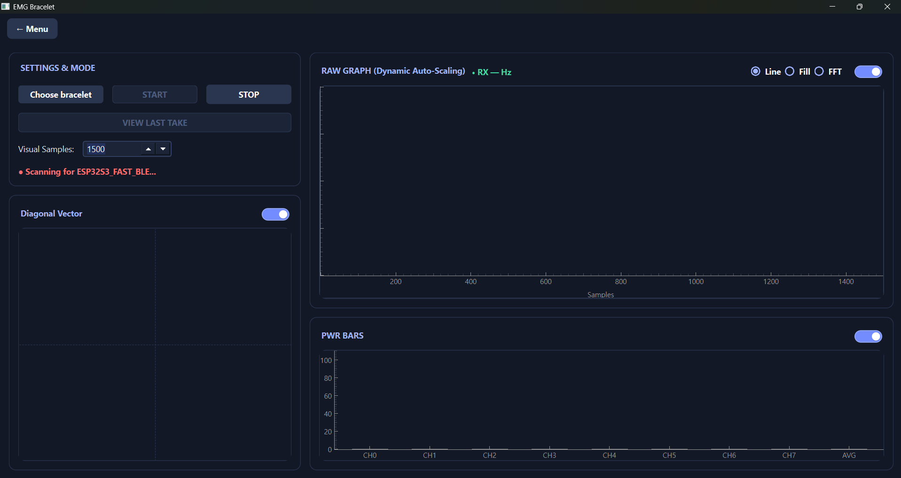

1. **START**를 누릅니다. (팔찌가 여러 개면 먼저 **Choose bracelet**으로 고릅니다. [9절](#9-팔찌-선택-창-choose-bracelet))
2. 왼쪽 위 상태가 빨간 `● Scanning for ESP32S3_FAST_BLE...`로 바뀌며 팔찌를 찾습니다. 이때 그래프는 아직 비어 있습니다.
3. 연결되면 초록 `● CONNECTED: ESP32S3_FAST_BLE`로 바뀌고 그래프가 움직이기 시작합니다. **START**는 흐려지고 **STOP**이 눌리는 상태가 됩니다.

**SETTINGS & MODE (왼쪽 위)**

| 화면 요소 | 설명 |
|---|---|
| **Choose bracelet** | 연결할 팔찌를 고릅니다. |
| **START** / **STOP** | 신호 받기 시작 / 멈춤 |
| **VIEW LAST TAKE** | 방금 START~STOP 사이의 신호를 그래프 창으로 엽니다(임시 파일, 저장 안 됨). STOP 뒤에 눌립니다. |
| **Visual Samples** | 그래프에 한 번에 보여 줄 샘플 수입니다. 클수록 더 긴 시간을 보여 줍니다(1500 ≈ 1.3초). |
| 연결 상태 | `● Scanning for ...`(빨강, 찾는 중) → `● CONNECTED: ...`(초록, 연결됨) |

### 그래프 보기: Line / Fill / FFT

가운데 위 그래프는 오른쪽 위의 **Line / Fill / FFT** 중 하나를 골라 봅니다. 그래프는 채널마다 색이 다르고, 위에서부터 CH0~CH7 순서입니다. 각 그래프 오른쪽 위의 스위치로 그 그래프를 끄고 켤 수 있습니다(PC가 느리면 안 보는 그래프를 끄세요).

**Line: 신호를 선으로 보기 (기본)**

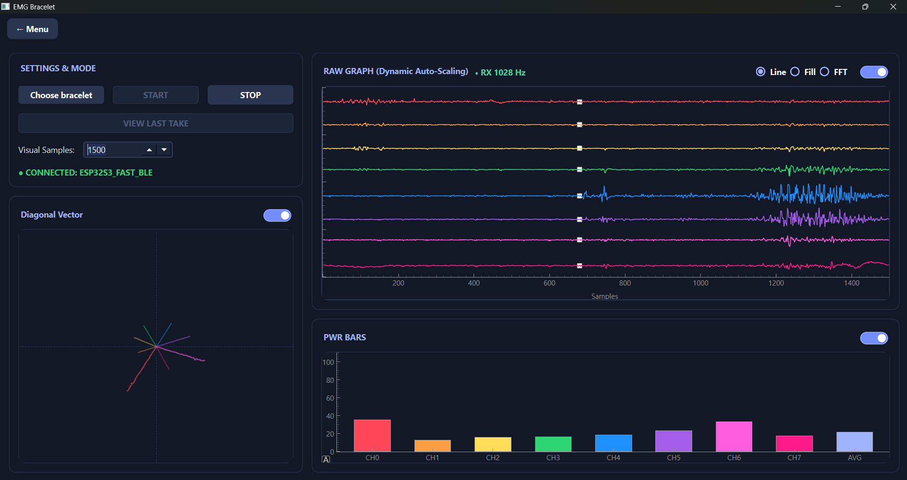

- 8개 채널의 신호가 위아래로 나뉘어 선으로 그려집니다. 크기는 자동으로 맞춰집니다.
- 그래프 제목 옆 `• RX 1028 Hz`는 초당 받는 샘플 수입니다. 정상은 약 1,000~1,200 Hz이고, 크게 떨어지면 연결이 불안정한 것입니다.
- 선 중간의 작은 흰 네모는 지금 새 데이터가 그려지는 위치입니다. 그래프는 왼쪽에서 오른쪽으로 덮어쓰며 돌아갑니다.
- 위 화면은 힘을 빼고 있다가 오른쪽 끝(최근)에 손을 움직인 순간입니다. 쉬는 동안은 선이 평평하고, 움직이면 CH4·CH5처럼 해당 근육 쪽 채널이 크게 흔들립니다. **쉬고 있는데도 계속 크게 흔들리는 채널이 있으면 그 센서의 접촉이나 잡음을 확인하세요.**

**Fill: 신호 크기를 막대로 보기**

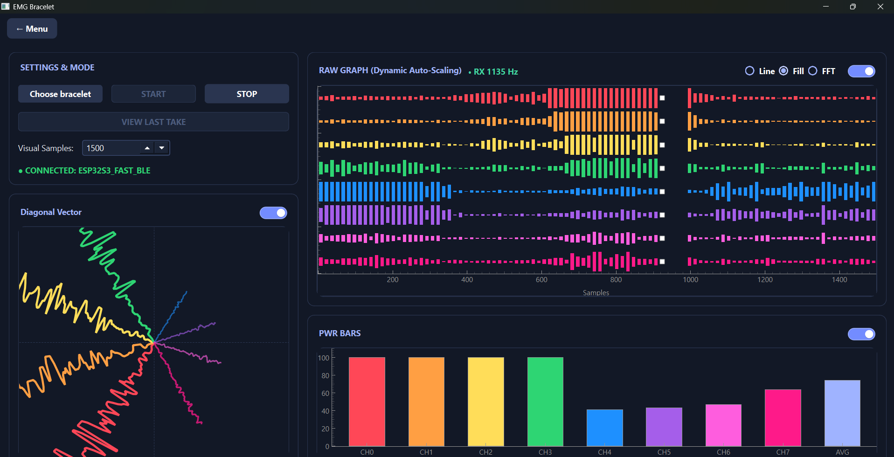

- 신호 크기를 막대로 채워 그립니다. 막대가 길수록 그 순간 근육 신호가 큽니다. 힘을 준 구간이 한눈에 보입니다.
- 위 화면에서는 왼쪽 구간에 CH4·CH5가, 가운데 구간에 CH0~CH3이 크게 올라갑니다. 동작마다 커지는 채널이 다르게 나타나야 모델이 동작을 잘 구분합니다.

**FFT: 주파수로 보기**

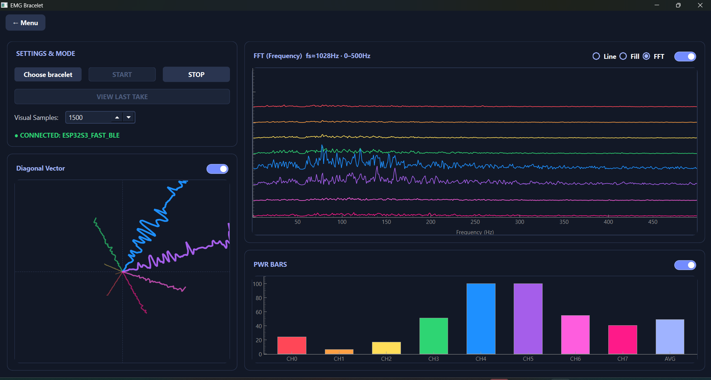

- 신호를 주파수별 세기로 바꿔 보여 줍니다. 제목의 `fs≈1028Hz · 0–500Hz`는 초당 샘플 수와 보여 주는 주파수 범위입니다.
- 근육 신호는 보통 약 50~150 Hz에서 크게 나타납니다. 위 화면에서 힘을 준 CH4·CH5가 이 구간에서 솟아 있습니다.
- 한 주파수에만 바늘처럼 뾰족한 봉우리가 계속 있으면(예: 전원 잡음 60 Hz) 잡음입니다. 노트북 충전기를 빼거나 팔찌를 다시 차 보세요.

### 옆 그래프

**Diagonal Vector (왼쪽 아래)**

채널마다 다른 방향으로 선을 그려, 8개 채널의 세기를 한 그림에 모아 보여 줍니다. 쉬고 있으면 가운데에 작게 모여 있고(Line 화면), 힘을 주면 해당 채널 방향으로 선이 길게 뻗습니다(Fill·FFT 화면). 동작마다 뻗는 방향이 다르게 나타나면 잘 구분되고 있는 것입니다.

**PWR BARS (오른쪽 아래)**

채널별 신호 세기(CH0~CH7)와 평균(AVG)을 막대로 보여 줍니다. 힘을 주면 막대가 올라가고, 쉬면 내려가야 합니다. 어떤 채널이 늘 0에 가깝다면 그 센서가 피부에 닿지 않은 것이고, 쉬는데도 늘 높다면 잡음이 많은 것입니다.

---

## 9. 팔찌 선택 창 (Choose bracelet)

Phase 3·4·5와 EMG sensors debugging에 있는 **Choose bracelet** 버튼을 누르면 주변의 블루투스 장치를 찾아 목록으로 보여 줍니다.

- 장치마다 이름, 주소, 신호 세기(RSSI)가 나옵니다. 팔찌 이름은 `ESP32S3_FAST_BLE`이고, 목록에서 따로 표시됩니다.
- 신호 세기 값이 클수록(0에 가까울수록) 가까운 장치입니다. 같은 이름이 여러 개면 팔찌를 PC 가까이 가져가 가장 센 것을 고르세요.
- 고른 팔찌는 앱을 끌 때까지 기억합니다. 고르지 않으면 이름이 맞는 첫 번째 팔찌에 연결합니다.

---

## 10. 저장되는 파일

| 내용 | 위치 |
|---|---|
| 녹화 데이터 (take마다 CSV 1개) | `data/<피험자ID>_BATCH<번호>/` (예: `data/S001_BATCH8/20261110_133304_emg.csv`) |
| 학습한 모델 | `models/trained/model_<피험자ID>_<동작묶음>_<날짜>.keras` |
| 피험자 목록 | `client_app/subjects.xlsx` |
| 학습 기록과 정확도 | `client_app/sessions.xlsx` |
| Phase 5 점수 측정 결과 | `benchmarks/live_<Label>.csv` |

---

## 11. 자주 겪는 문제

**팔찌가 연결되지 않아요 (`Bracelet: disconnected`에서 바뀌지 않음)**
- 팔찌 LED 색을 봅니다. 주황색이면 아직 PC와 연결되지 않은 것이고, 연결되면 파란색으로 바뀝니다.
- 팔찌 전원이 켜져 있는지, PC 블루투스가 켜져 있는지 확인합니다.
- 다른 프로그램(다른 앱 창 포함)이 팔찌에 연결되어 있으면 끊습니다.
- **Choose bracelet**으로 목록에 팔찌가 보이는지 확인합니다.

**`Detected port`에 팔찌가 안 나와요**
- 데이터 전송이 되는 USB 케이블인지 확인합니다(충전 전용 케이블은 안 됩니다).
- 다른 USB 포트에 꽂고 **Refresh**를 누릅니다.

**녹화 중 신호가 끊겨요**
- 터미널의 `[BLE] ... Hz` 줄이 멈췄는지 봅니다. 멈췄다면 팔찌와 PC 사이를 가깝게 하고 다시 연결합니다.

**정확도가 낮아요**
- [take 뷰어](#take-뷰어)로 녹화를 확인하고, 신호가 약하거나 잡음이 많은 take는 지우고 다시 녹화합니다.
- [혼동 행렬](#4-load-an-old-session-예전-모델-불러오기)에서 헷갈리는 동작 쌍을 찾아, 그 동작들을 더 확실히 다르게 녹화합니다.
- take가 10개보다 적으면 더 녹화합니다.

**Phase 4·5에서 인식 결과가 안 나와요**
- Phase 3에서 모델 설치가 끝났는지 확인합니다.
- 팔찌를 껐다 켜고 **Start verification**을 다시 누릅니다.
